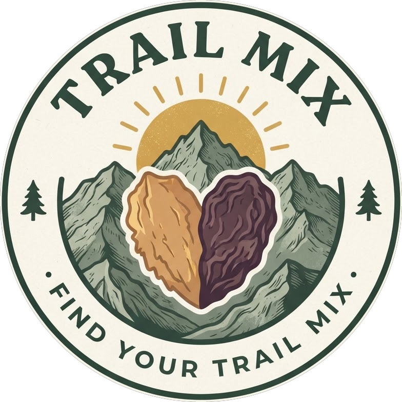
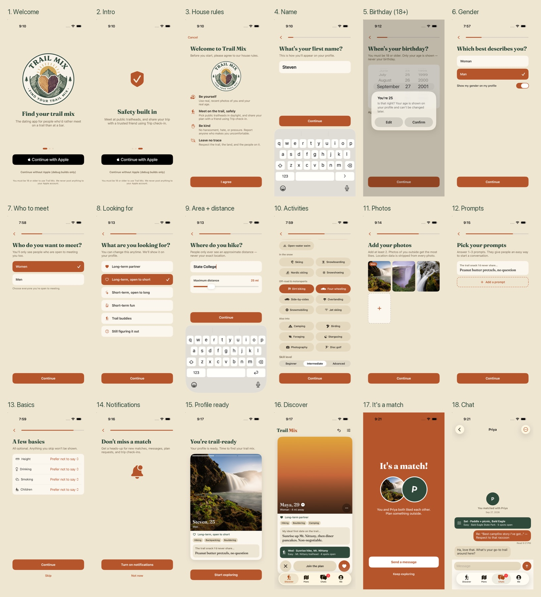
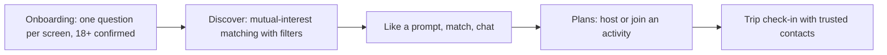

  

  
<strong>The dating app for single granola people.</strong>

     

> **Showcase repository.** The source code for TrailMix is not published. This page presents what the product is and how it works.

## Screenshots

The onboarding flow through Discover, match and chat (simulator, light theme).

  

## Overview

A native iOS dating app for outdoorsy people. Match on shared activities, plan real trips together, chat, and use built-in safety tools like trip check-ins and trusted contacts.

## How it works

## Features

- Sign in with Apple only; Supabase auth + RLS
- Discover feed with age, distance, goal and activity filters; like / pass / undo
- Plans: create, join and host real outings
- Chat with typing indicator, read receipts, icebreakers
- Safety center: report, block, unmatch, meeting tips, account deletion
- Custom "Granola Warm" light / "Golden Hour" dark design system with bundled Fraunces display font
- Local demo mode with sample people when no keys are configured

## Tech stack

| Layer | Choice |
|---|---|
| Language / UI | Swift 6, SwiftUI, iOS 17+, XcodeGen |
| Backend | Supabase: Postgres, Auth, Realtime, Storage, RLS |
| Design | Asset-catalog tokens, Fraunces (OFL) + SF Pro |
| Tests | XCTest + Supabase security tests |

## Privacy & security

Photos are stripped of GPS/EXIF and downscaled. Birthdate is never shown, only age. Account deletion is built in.

## Brand

| | Name | Hex | Role |
|---|---|---|---|
|  | Granola | `#EFE6D2` | Light background |
|  | Pine | `#2F4A3A` | Brand green |
|  | Clay | `#B4552B` | Accent |
|  | Night | `#1B1F2E` | Dark background |
|  | Golden Hour | `#F2A65A` | Dark accent |

**Mark.** Circular badge: a heart split into an almond half and a raisin half, flanked by pine trees. "Find your trail mix."

**Voice.** Warm, a little cheeky, outdoorsy. Safety copy stays plain and serious.

## Roadmap

- Missed check-in alerts (UI only today)
- Push notifications
- Photo / ID verification
- Image moderation
- Analytics decision
- Launch region

## Notes

Brief: `TrailMix-Build-Brief.md`. Design explorations in `Design/`.

## License

Proprietary. Shared publicly for portfolio and demonstration purposes only. See [LICENSE](LICENSE).

---

Built by [Aquila Digital LLC](https://github.com/Steven6Brown) · *Per Aspera Ad Astra*

